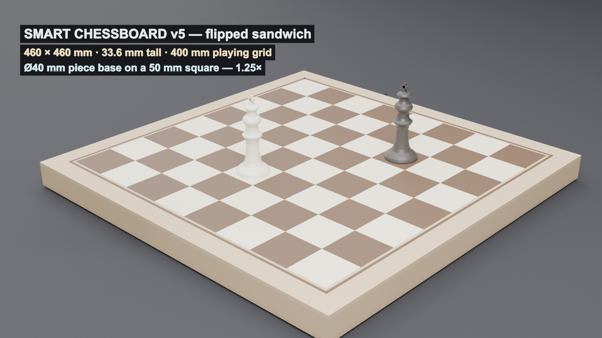
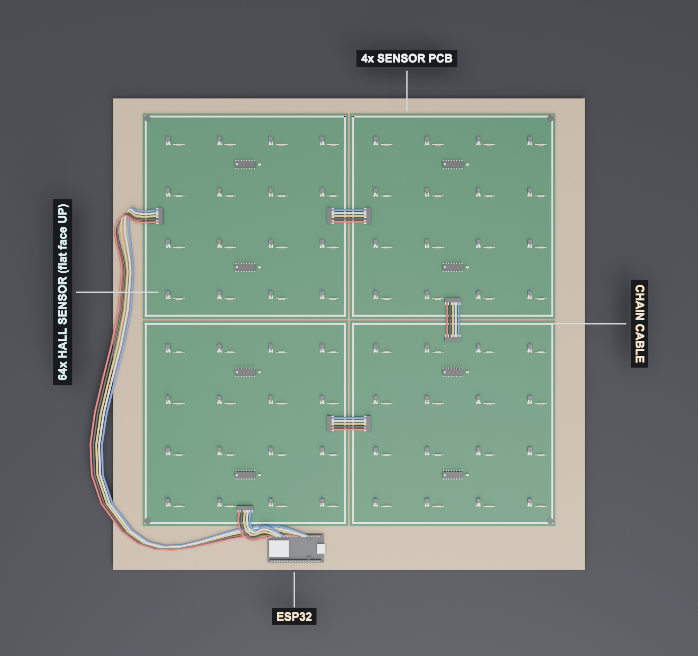
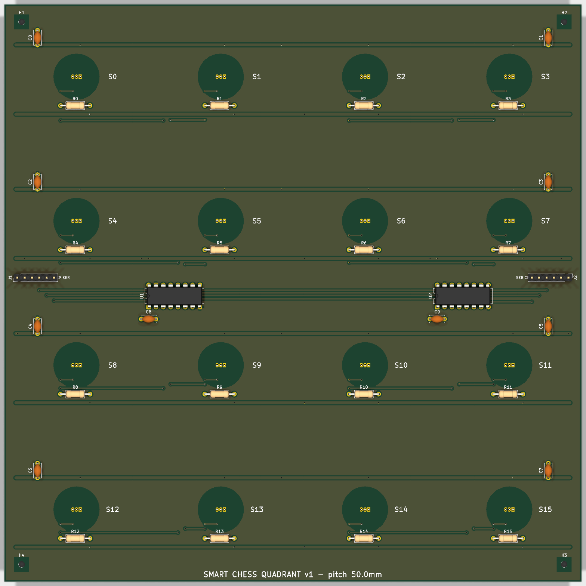

# Smart Chessboard: hardware

A 64-square chessboard that detects where pieces stand with one Hall-effect sensor per square, read by an ESP32 and sent out over USB serial or Wi-Fi.



*Render of the enclosure design for the sensing board (the renders call it "v5"). Renders, not photos.*

## What it is for

Tournament chess is played on a real board, but engines, training tools and online opponents all live on a screen. This board joins the two. You move real pieces, the board reads the position, and a chess app on a computer treats it as your move: against an engine, in a training exercise, or in a live Lichess game. The reply shows in the app and you play it on the board.

My brother plays over-the-board tournaments and practises on this board every day.

## How it works



1. **A magnet in each piece.** Each piece carries a 10 x 3 mm N35 neodymium disc in its base.
2. **A sensor under each square.** An A3144 Hall-effect switch sits at the centre of each 50 mm square, on the underside of the PCB, bent flat. The A3144 responds to one magnet pole only, so every magnet is glued with its working face down.
3. **10k pull-ups.** Each sensor output has a 10 kΩ pull-up to 3.3 V. A magnet pulls the line low, so an occupied square reads as 0.
4. **74HC165 shift registers.** Two 74HC165 parallel-in shift registers per board latch 16 sensor states at once. The registers run at 3.3 V and the sensors at 5 V, so the ESP32 never sees 5 V on a data line.
5. **Four identical boards.** The board is four 200 x 200 mm quadrant PCBs of 16 squares each, chained J2 to J1 with 6-wire jumpers. The chain carries power and signals, and the four boards together form one 64-bit shift chain.
6. **Three wires to the ESP32.** The ESP32 drives /PL (GPIO25) and CP (GPIO26) and reads the chain's data out on GPIO27. GPIO14 injects a test pattern into the chain for the gate test.
7. **USB serial or Wi-Fi out.** The firmware sends one line per frame, `raw = 0x` followed by 16 hex digits, about 50 times a second, over USB serial, or over USB and a Wi-Fi TCP connection at the same time.

In the enclosure design, the boards hang component side down on 20 mm standoffs between two 4 mm MDF sheets. The magnet sits 7.1 mm from the sensor: 4.0 mm MDF, 1.0 mm air gap, 1.6 mm PCB and about 0.5 mm into the sensor package. Dimensions, cut list, drilling, jumper lengths and assembly order are in [docs/MECHANICAL.md](docs/MECHANICAL.md).

## Hardware

| Board | What it is | Status |
|---|---|---|
| [Quadrant v1](pcb/quadrant/) | 200 x 200 mm, 2-layer, all through-hole. 16 A3144, 16 x 10k, 2 x 74HC165 (DIP-16), 10 x 100 nF, two 1x6 headers. 50 mm squares. | Fabricated (5 boards). Four assembled, chained and tested. |
| [Quadrant v2](pcb/quadrant_v2/) | 132 x 132 mm, 2-layer, all SMT for factory assembly. 33 mm squares, UHE4913G omnipolar Hall sensor and WS2812C-2020 LED per square, keyed 2x6 ribbon connectors. | Design only. DRC-clean, gerbers exported. Not ordered as of 2026-09-01. |
| [Hub v2](pcb/hub_v2/) | 88 x 60 mm. ESP32-WROOM-32E module, Micro-USB, CH340C USB-serial, TP4056 charger and 18650 holder (protected cell required). | Design only. DRC-clean, gerbers exported. Not ordered as of 2026-09-01. |
| [Hub v3 USB-C](pcb/hub_v3_usbc/) | Hub v2 with the Micro-USB port replaced by USB-C and 5.1 kΩ CC pull-downs. | Design only. DRC-clean, gerbers exported. No order recorded. |
| [RFID test rig](pcb/rfid_test_rig/) | 80 x 92 mm, 4-layer, 2x2 squares. Tests 125 kHz antenna coils under each square, an EM4095 reader and 74HC4851 muxes, toward identifying pieces as well as detecting them. | Design only. DRC-clean, gerbers exported. No order recorded. |



Notes for builders:

- The A3144 parts used on the v1 boards were mirror-pinout clones and had to go in rotated 180 degrees from a genuine part. Read [pcb/quadrant/assembly/ASSEMBLY_NOTES.md](pcb/quadrant/assembly/ASSEMBLY_NOTES.md) and solder one sensor at S0 and test it with a magnet before soldering the other 15.
- The v1 board is generated from one number, the square size. To regenerate it, follow [pcb/quadrant/README.md](pcb/quadrant/README.md).
- Design notes: [pcb/DESIGN.md](pcb/DESIGN.md) (v1), [pcb/DESIGN_V2.md](pcb/DESIGN_V2.md) (v2 compact board), [pcb/DESIGN_V3_RFID.md](pcb/DESIGN_V3_RFID.md) (RFID piece recognition, paper design).
- Per-board parts list: [pcb/quadrant/assembly/chess_quadrant_bom.csv](pcb/quadrant/assembly/chess_quadrant_bom.csv). Fasteners and wood: [docs/MECHANICAL.md](docs/MECHANICAL.md) sections 4 and 6.
- Datasheets: [A3144](https://www.allegromicro.com/en/products/sense/switches-and-latches) (Allegro, discontinued; the boards use clones), [SN74HC165](https://www.ti.com/product/SN74HC165) (TI), [ESP32](https://www.espressif.com/en/products/modules/esp32) (Espressif).

## Firmware

Arduino sketches for an ESP32 dev board, one folder per sketch in [firmware/](firmware/).

| Sketch | Use it for |
|---|---|
| `board_stream` | Main firmware, USB only. Measures the chain length at boot, streams frames at about 50 per second, re-runs the gate test every 5 s. |
| `board_stream_wifi` | Same sensing code, plus Wi-Fi: every line goes to USB serial and to a TCP connection. Adds over-the-air updates and a status page on port 80. |
| `read_audit` | Reads the board four ways and compares them. Run it before blaming a sensor. |
| `chain_len` | Counts the shift-register stages in the chain. The gate test passes on a chain that is too short; this finds it. |
| `quadrant_test`, `quadrant_diag` | Single-board bring-up. |
| `quadrant_diag32`, `quadrant_diag64` | 2-board and 4-board gate tests. |
| `dgt_clock_bridge` | A second ESP32 that connects a DGT 3000 chess clock through its 3.5 mm jack, over USB serial and Wi-Fi. |
| `adc_diag`, `rail_test`, `short_meter`, `wiring_diag`, `sensor_test`, `quad_probe`, `quadrant_diag2`, `quadrant_diag3` | One-off diagnostic rigs from bring-up. |

The gate test shifts all 0s and then all 1s through the chain and prints `CHAIN64: PASS` or `FAIL`. An all-clear frame reads the same as a dead chain, so check the gate result before trusting a reading.

[firmware/tools/](firmware/tools/) has Python serial readers and live dashboards for bring-up (no dependencies; edit the port at the top of each script).

### Flash over USB

You need `arduino-cli` with the ESP32 core. Close any program reading the serial port first.

```bash
cd firmware
arduino-cli compile --fqbn esp32:esp32:esp32 board_stream
arduino-cli upload -p <your-port> --fqbn esp32:esp32:esp32 board_stream
```

On macOS the port looks like `/dev/cu.usbserial-0001`.

### Set up Wi-Fi

1. Copy the template: `cp firmware/board_stream_wifi/secrets.example.h firmware/board_stream_wifi/secrets.h`
2. In `secrets.h`, set `WIFI_SSID` and `WIFI_PASS` (2.4 GHz networks only), `SCB_HOST` (the mDNS name of the computer that receives the stream) and `SCB_FALLBACK_IP` (that computer's address, used only on first boot). `secrets.h` is in `.gitignore`.
3. Flash once over USB: `firmware/board_stream_wifi/flash.sh <your-port>`
4. Power the ESP32 from a 5 V USB charger, 2 A or more.
5. Later updates go over Wi-Fi: `firmware/board_stream_wifi/ota.sh`

The board answers at `chess-sensor.local`, with a status page showing Wi-Fi signal, connection state and the last gate result. The helper scripts are written for macOS. The clock bridge uses the same steps in `firmware/dgt_clock_bridge/`.

## Status

- **2026-11-14:** In daily use for tournament practice.
- **2026-08-24:** Five v1 quadrant PCBs fabricated. Four assembled and chained into a 64-square board that passes the 64-stage gate test, detects a full set of 32 pieces, and streams over Wi-Fi. The wooden frame and playing surface in [docs/MECHANICAL.md](docs/MECHANICAL.md) were still listed as pending on this date.
- **2026-09-26:** DGT 3000 clock bridge tested on a real clock.
- **2026-09-26:** Quadrant v2, hub v2, hub v3 and the RFID test rig are designed and DRC-clean. No fabrication of these boards is recorded.

## Software

The board feeds a separate chess app that runs on a computer. It plays against engines (Stockfish and Maia), has training modes, and plays Lichess games from the physical board. That app is not in this repository.

## Repository layout

| Path | Contents |
|---|---|
| [pcb/](pcb/) | KiCad boards, generator and routing scripts, design notes, gerbers, BOMs, plots |
| [pcb/quadrant/assembly/](pcb/quadrant/assembly/) | Assembly notes, solder job sheets, pick-and-place, BOM |
| [firmware/](firmware/) | ESP32 sketches and the [firmware README](firmware/README.md) |
| [firmware/tools/](firmware/tools/) | Python serial readers and bring-up dashboards |
| [docs/MECHANICAL.md](docs/MECHANICAL.md) | Enclosure stack-up, cut list, drilling, wiring lengths, assembly order |
| [docs/WORKING_SETUP_2026-08-18.md](docs/WORKING_SETUP_2026-08-18.md) | Exact wiring and bit order of the first working 2-board chain |
| [docs/stickers/](docs/stickers/) | Printable 440 x 440 mm board decals, their generator and how to apply them |
| [renders/](renders/) | Renders of the board designs, including earlier LED concepts that were not built |
| [diagrams/](diagrams/) | Generator for the single-sensor test wiring diagram |
| [sim/](sim/) | SPICE model for the `short_meter` rig |
